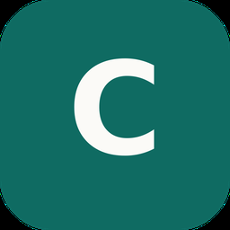
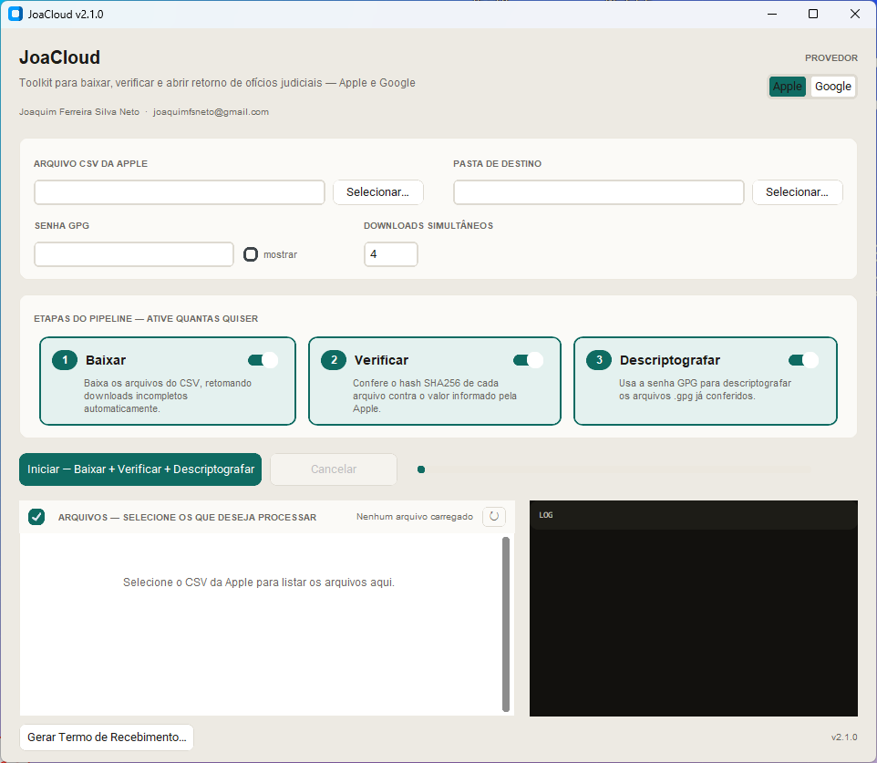

<p align="center">
  
</p>

<h1 align="center">JoaCloud</h1>

<p align="center">
  <a href="https://github.com/joasource/JoaCloud/actions/workflows/ci.yml"></a>
  <a href="https://github.com/joasource/JoaCloud/actions/workflows/release.yml"></a>
  <a href="https://github.com/joasource/JoaCloud/releases/latest"></a>
  
  
  <a href="LICENSE"></a>
</p>

Programa para processar o retorno que a **Apple** e o **Google** mandam em
resposta a um ofício judicial:

- **Apple**: ele **baixa** os arquivos do CSV, **confere** se cada um baixou
  certinho (hash SHA-256) e **descriptografa** os arquivos `.gpg` usando a
  senha que a Apple forneceu.
- **Google**: ele faz o login no portal **LERS** pelo seu navegador,
  **baixa** os ZIPs e PDFs do request e **confere** o hash SHA-512 de cada
  pacote contra os valores que o Google informa. Os ZIPs ficam exatamente
  como o Google entregou: nada é extraído.

Você pode rodar as etapas juntas ou escolher só as que precisa (por
exemplo, só conferir arquivos que já foram baixados antes). No fim, o
programa gera o **Termo de Recebimento** com os hashes conferidos.

Autor: Joaquim Ferreira Silva Neto — joaquimfsneto@gmail.com

<p align="center">
  
</p>

## O que você precisa antes de começar

**Apple**
- O **arquivo CSV** que a Apple te mandou (a lista com os links dos arquivos).
- A **senha** que a Apple forneceu, se você for descriptografar os arquivos `.gpg`.
- Para a etapa de descriptografar, o programa precisa do **GnuPG**:
  - **Windows**: já vem embutido no `JoaCloud.exe` — não precisa instalar nada.
  - **Linux**: usa o `gnupg` do sistema, que normalmente já vem instalado; se
    não vier, instale o pacote `gnupg` da sua distribuição.

**Google**
- Uma conta com acesso ao **LERS** (lers.google.com), com a verificação em
  duas etapas que o próprio LERS exige.
- Um navegador baseado em Chromium instalado: **Edge** (já vem no Windows),
  Chrome, Chromium ou Brave.
- Se você já baixou os arquivos do LERS por conta própria, dá pra pular o
  login: basta apontar o programa para a pasta com os ZIPs e PDFs.

## Como baixar e abrir o programa

Baixe a versão do seu sistema na página de releases:
**https://github.com/joasource/JoaCloud/releases**
(o que mudou em cada versão está no [CHANGELOG](CHANGELOG.md))

- **Windows**: baixe `JoaCloud.exe` e dê dois cliques para abrir.
  - O Windows pode mostrar um aviso azul ("O Windows protegeu o computador").
    Isso acontece porque o programa não tem certificado pago da Microsoft,
    não porque tem algo de errado. Clique em **Mais informações** e depois em
    **Executar assim mesmo**.
- **Linux**: baixe `JoaCloud-x86_64.AppImage`, dê permissão de execução e rode:
  ```bash
  chmod +x JoaCloud-x86_64.AppImage
  ./JoaCloud-x86_64.AppImage
  ```
  Se aparecer erro relacionado a FUSE, rode assim:
  ```bash
  ./JoaCloud-x86_64.AppImage --appimage-extract-and-run
  ```

## Como usar — Apple

1. Abra o programa e deixe **Apple** selecionado em **Provedor** (canto superior direito).
2. Em **Arquivo CSV da Apple**, clique em Selecionar e escolha o CSV que a Apple te enviou.
3. Em **Pasta de destino**, escolha onde os arquivos vão ser salvos.
4. Se for descriptografar, preencha a **Senha GPG** com a senha que a Apple forneceu.
5. Em **Etapas do pipeline**, marque o que você quer que rode:
   - **Baixar** — baixa os arquivos do CSV.
   - **Verificar** — confere se o hash de cada arquivo bate com o informado pela Apple.
   - **Descriptografar** — usa a senha para abrir os arquivos `.gpg`.

   Pode marcar as três, só uma, ou duas — o botão mostra a combinação escolhida.
6. Clique em **Iniciar** e acompanhe a lista de arquivos e o log na tela.

Ao final, na pasta de destino você vai encontrar:
- Os arquivos baixados (como a Apple mandou, ainda `.gpg` se estiverem criptografados).
- Uma subpasta `decriptado/` com os arquivos já descriptografados.
- Um arquivo `joacloud_log.txt` com o histórico de cada etapa (data e hora).

Rodar o programa de novo em cima da mesma pasta é seguro: arquivos que já
foram baixados, já conferidos ou já descriptografados são identificados e
pulados automaticamente — nada é refeito à toa.

## Como usar — Google (LERS)

1. Abra o programa e selecione **Google** em **Provedor**.
2. Clique em **Baixar do LERS…**. O programa abre o navegador numa janela
   própria do JoaCloud, já no LERS.
3. Faça o login normalmente nessa janela (e-mail, senha e verificação em
   duas etapas). O login fica salvo nesse perfil do navegador para as
   próximas vezes. Sua senha e os cookies da sessão nunca passam pelo
   JoaCloud.
4. A lista de requests da sua conta aparece no programa, com os que têm
   arquivos disponíveis primeiro (o LERS pode levar alguns segundos para
   responder). Escolha o request e a pasta onde salvar, e clique em **Baixar**.
   - Antes do primeiro download, o Google pode pedir para você confirmar a
     senha — isso acontece na janela do navegador, uma vez por sessão.
   - São baixados os ZIPs de produção e as cartas/PDFs do Google. O ofício
     enviado pelo próprio órgão só vem se você marcar a opção correspondente.
5. Ao terminar, a pasta baixada já fica escolhida em **Pasta com o retorno do
   LERS**. Escolha a **Pasta de destino** (pode ser a mesma) e clique em
   **Iniciar**:
   - **Baixar** — copia os ZIPs e PDFs para o destino, byte a byte, sem
     alterar nada (se o destino for a própria pasta do LERS, não copia nada).
   - **Verificar** — confere o SHA-512 de cada pacote de dados contra os
     valores que o Google informa no PDF "Valores de Hash" (ou na carta).

O Google manda cada pacote de dados (`<conta>.<num>.<Serviço>..._001.zip`)
dentro de um ZIP de produção. O hash é conferido lendo o pacote direto de
dentro do ZIP de produção, sem extrair nem descompactar nada em disco: os
arquivos que ficam na pasta são exatamente os que o Google entregou. Por
isso o Google não tem a terceira etapa.

Se você já tem a pasta baixada do LERS, pule os passos 2 a 4 e escolha a
pasta em **Selecionar…**.

## Modo texto (`--no-gui`, só no Linux)

No Linux, dá pra rodar tudo isso sem abrir janela nenhuma, direto do
terminal — útil pra servidor, script ou automação:

```bash
./JoaCloud-x86_64.AppImage --no-gui run --csv retorno.csv --output-dir ./saida
./JoaCloud-x86_64.AppImage --no-gui list --csv retorno.csv
./JoaCloud-x86_64.AppImage --no-gui delete --csv retorno.csv --output-dir ./saida --only arquivo.txt.gpg
./JoaCloud-x86_64.AppImage --no-gui report --responsavel "Fulano" --format docx --out termo.docx

# Google: login no LERS pelo navegador, download e conferência dos hashes
./JoaCloud-x86_64.AppImage --no-gui lers --list
./JoaCloud-x86_64.AppImage --no-gui lers --request <Ref. Interna> --output-dir ./saida
# Google: conferir uma pasta já baixada do LERS
./JoaCloud-x86_64.AppImage --no-gui run --provider google --source ./pasta_lers --output-dir ./pasta_lers
```

Se faltar alguma informação obrigatória (ex.: `--csv`/`--source`), ou se você passar
`--menu`/`-i`, um menu interativo simples pergunta o que falta — mesma
lógica da GUI, sem depender de nenhuma biblioteca nova.

A senha do GPG nunca vai numa flag em texto puro (ficaria visível em
`ps aux`/histórico do shell). Use uma destas opções:
- Prompt interativo (padrão, se o terminal permitir).
- `--passphrase-env NOME_DA_VARIAVEL` — lê de uma variável de ambiente já setada.
- `--passphrase-stdin` — lê uma linha do stdin: `echo "senha" | ... --passphrase-stdin`.

Rode `./JoaCloud-x86_64.AppImage --no-gui --help` (ou `run --help`,
`report --help` etc.) pra ver todas as opções de cada subcomando. O `.exe`
do Windows não tem esse modo — só a GUI.

## Se der algum problema

- **"gpg não foi encontrado no PATH"**: no Windows isso não deveria acontecer
  (o GnuPG vem embutido); no Linux, instale o pacote `gnupg` da sua
  distribuição.
- **"Hash inválido"** num arquivo: ele baixou incompleto ou corrompido.
  Apague o arquivo da pasta de destino e rode o programa de novo só com
  "Baixar" e "Verificar" marcados.
- **Senha incorreta**: o programa avisa qual arquivo falhou ao descriptografar;
  confira a senha exatamente como a Apple enviou (maiúsculas/minúsculas importam).
- **"Nenhum navegador compatível encontrado"** (Google): instale o Edge,
  Chrome, Chromium ou Brave.
- **"O navegador fechou logo ao abrir"** (Google): já existe uma janela do
  navegador do JoaCloud aberta que o programa não consegue controlar (por
  exemplo, sobrou de um uso anterior). Feche essa janela e tente de novo.
- **"O download ... não começou"** (Google): a confirmação de senha pedida
  pelo Google não foi concluída a tempo na janela do navegador. Clique em
  **Baixar** de novo; o que já foi baixado é pulado.
- **"Sem hash informado pelo provedor"** (Google): o programa não achou o
  valor daquele pacote nos PDFs da pasta. Confira se a carta ou o PDF
  "Valores de Hash" do request foi baixado junto.

---

### Para quem for mexer no código

O código-fonte fica em `joacloud/` (`core.py` é o motor do pipeline,
genérico; `providers/` tem o que é específico de cada nuvem — `apple.py`
com CSV e GPG, `google.py` com os ZIPs e o PDF de hashes do LERS; `lers.py`
é o login/download do LERS pelo navegador via Chrome DevTools Protocol;
`gui.py` é a interface gráfica, `cli.py` é o modo texto Linux-only e
`app.py` é o ponto de entrada único que escolhe entre os dois conforme a
flag `--no-gui`). Os executáveis são gerados automaticamente pelo GitHub
Actions (`.github/workflows/release.yml`) a cada tag `vX.Y.Z` enviada ao
repositório — o `.exe` do Windows compila a partir de `gui.py` direto (sem
CLI); o AppImage do Linux compila a partir de `app.py`. Os arquivos em
`legacy/` (`baixar.py`, `conferir.py` e `decriptar.py`) são os scripts
originais, mantidos só como referência histórica.

Os testes automatizados (`joacloud/tests/`) cobrem o motor do
pipeline: leitura de CSV, download, verificação de hash e descriptografia
(com um `gpg` real, se disponível no PATH), e, no Google, a leitura do PDF
de hashes, a conferência dentro dos ZIPs e o cliente do LERS (com respostas
e navegador simulados — nunca com dados reais de caso). Rodam a cada push/PR via
`.github/workflows/ci.yml`. Pra rodar localmente:
```bash
pip install -r joacloud/requirements-dev.txt
pytest joacloud/tests -v
```

O ícone do app fica em `packaging/`, gerado por `packaging/make_icon.py`
(requer `pip install Pillow`): `linux/icon.png` é reaproveitado no
AppImage, na janela em tempo de execução (`gui.py`) e neste README;
`windows/icon.ico` é a versão multi-resolução usada no `.exe`;
`icon-1024.png` é uma cópia em alta resolução pra material de divulgação.
Pra mudar o design (cor, monograma), edite `make_icon.py` e rode
`python packaging/make_icon.py` de novo — ele regenera os três arquivos.

---

## Licença

Este projeto é distribuído sob a [GNU General Public License v3.0](LICENSE)
(GPL-3.0). Em resumo: você pode usar, estudar, modificar e redistribuir o
código livremente — inclusive comercialmente —, mas qualquer redistribuição
(modificada ou não) precisa continuar sob a mesma licença, manter os
créditos e avisos de copyright, e disponibilizar o código-fonte
correspondente. Não é permitido incorporar este código em software
proprietário/fechado.

Copyright (C) 2026 Joaquim Ferreira Silva Neto &lt;joaquimfsneto@gmail.com&gt;
